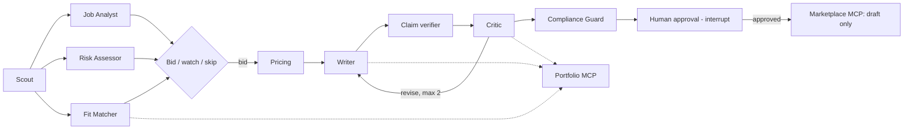

# GigBid — a multi-agent freelancer copilot

<!-- demo GIF goes here: docs/images/demo.gif (added at submission) -->

GigBid finds freelance jobs, judges whether they are worth bidding on, writes proposals grounded in
real portfolio evidence, and manages client conversations. A human approves every proposal and
message before it leaves the system. It runs against a marketplace simulator (GigSim) for
development and grading, and against Upwork's official MCP server for real use, through one
adapter interface.

**Status:** under active development (AI-4016 R&D assignment). Live link, traces and results
tables are filled in as milestones land.

| | |
|---|---|
| Live app | _coming soon_ (reviewer login shared privately) |
| Portfolio MCP server | _coming soon_ (PyPI / `uvx`) |
| Technical write-up | _coming soon_ |
| Public traces | _coming soon_ (skipped scam · approved proposal · critic loop · crash-and-resume) |

## How it works



Job Analyst, Risk Assessor and Fit Matcher run in parallel. A weak draft returns to the Writer at
most twice. Nothing is sent without a human approving it in the web UI; the graph pauses with a
LangGraph `interrupt()` and resumes from a Postgres checkpoint when the user decides.

Full architecture: [docs/ARCHITECTURE.md](docs/ARCHITECTURE.md). Decisions: [docs/adr/](docs/adr/).

## Results

All numbers below are produced by `make eval` and read from committed files in
[`evals/results/`](evals/results/). Tables are filled in as each evaluation lands.

### Retrieval variants (Part B)
<!-- results: evals/results/rag_results_table.md -->
_Pending: run `make eval-rag`._
<!-- /results -->

### Single agent vs supervisor vs hand-built graph (Part C)
<!-- results: evals/results/multiagent_comparison.json -->
_Pending._
<!-- /results -->

## Run it locally

```bash
cp .env.example .env            # fill GROQ_API_KEY (free) and LANGSMITH_API_KEY (free)
make install                    # uv sync + npm install
make up                         # docker compose: postgres(pgvector), redis, gigsim, mcp servers, api, worker, web
make seed                       # personas + reviewer login
```

Then open http://localhost:3000. Developer loop without Docker for the app itself: `make dev`.

Signature extension: **X3 Portfolio builder** — see [docs/EXTENSION.md](docs/EXTENSION.md).

## Repository map

| Path | What lives there |
|---|---|
| `agent/` | LangGraph state, hand-off models, both graphs, nodes, versioned prompts, memory rules, model config |
| `rag/` | Portfolio ingestion, indexes, retrieval variants V0–V9, claim verification |
| `mcp_servers/` | Portfolio (read), Marketplace (GigSim / Upwork adapters, write tools), Workspace |
| `apps/api`, `apps/web` | FastAPI backend with SSE streaming; Next.js frontend |
| `worker/` | Scheduled scouting and long runs (Arq on Redis) |
| `gigsim/` | Marketplace simulator used for development and grading |
| `evals/` | Datasets, runners, committed results |
| `docs/` | Architecture, ADRs, tools inventory, data card, runbook, extension, AI usage |

## Pinned versions

Python dependencies are pinned in [`uv.lock`](uv.lock); web dependencies in
`apps/web/package-lock.json`. Key libraries are listed in [docs/ARCHITECTURE.md](docs/ARCHITECTURE.md).
