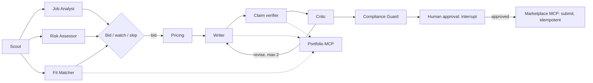

# GigBid: a multi-agent freelancer copilot that only claims what you can prove

<!-- demo GIF: docs/images/demo.gif (recorded at submission) -->

GigBid finds freelance jobs, decides which are worth paid Connects, writes proposals in which
**every claim links to real portfolio evidence**, and drafts replies to clients. A person approves
every proposal and message before anything leaves the system. It runs against a marketplace
simulator for development and grading, and against Upwork's official MCP server for real use,
through the same adapter.

| | |
|---|---|
| Live app | _deployment link added at submission_ (reviewer login shared privately) |
| Portfolio MCP server | [`gigbid-portfolio-mcp`](packages/gigbid-portfolio-mcp): `uvx --from "git+https://github.com/bilalabbasi14/gigbid#subdirectory=packages/gigbid-portfolio-mcp" gigbid-portfolio-mcp --portfolio ./my-work` |
| Signature extension | X3 Portfolio builder: GitHub repositories turned into case studies verified against the code ([docs/EXTENSION.md](docs/EXTENSION.md)) |
| Public traces | _added at submission_: skipped scam · approved proposal · Critic loop · crash and resume |

## What it does

1. **Scouts** saved searches on a schedule, de-duplicates reposts, and queues new jobs.
2. **Analyses each job with three agents in parallel**: a Job Analyst (structured JobSpec), a Risk
   Assessor (client history, scams, off-platform asks, injected instructions) and a Fit Matcher
   (every requirement mapped to portfolio evidence).
3. **Decides** bid, watch or skip with stated reasons, then prices the bid from market data, the
   client's budget, the freelancer's floor and whether the Connects are worth it.
4. **Writes** a proposal citing evidence inline, **verifies every claim** against that evidence
   (unsupported sentences are removed or rewritten), lets a Critic send it back at most twice, and
   runs a **Compliance Guard** over the platform policy. The policy is data: a platform update is
   a YAML edit that reaches the Guard, the Writer's prompt and pricing, and the app warns when the
   marketplace enforces a newer version ([rehearsal](evals/results/change_request_rehearsal.json)).
5. **Stops for the human**: the proposal studio shows the evidence behind each claim on hover, the
   Critic and Compliance notes, the price rationale and a dry-run preview of exactly what will be
   sent and what it costs. Approve, edit (re-checked, and learned as a style preference) or reject.
6. **Handles replies**: classifies intent, drafts an answer or proposes interview slots, and keeps
   the pipeline board current. Outcomes feed back into what GigBid learns.



Graphs are hand-written LangGraph `StateGraph`s, checkpointed in Postgres: kill the API while a
proposal waits for approval, restart it, approve, and the proposal is submitted exactly once.
Details: [docs/ARCHITECTURE.md](docs/ARCHITECTURE.md) · tools: [docs/TOOLS.md](docs/TOOLS.md) ·
operations: [docs/RUNBOOK.md](docs/RUNBOOK.md) · data: [docs/DATA_CARD.md](docs/DATA_CARD.md) ·
decisions: [docs/adr/](docs/adr/).

## Results

Every number below is produced by the runners in `evals/runners/` and read from committed files in
[`evals/results/`](evals/results/) by `evals/runners/results_table.py`. Models: the open profile
(open-weight models on Groq's free tier; open embedding and reranker models on CPU). Data: the
stand-in GigSim simulator and synthetic persona corpora described in the data card.

### Retrieval and proposal quality by RAG variant (Part B)
<!-- results: rag -->
| Variant | Evidence Recall@5 | MRR | nDCG@10 | Unsupported claims / proposal | Judge score | GigSim reply rate | p95 retrieval latency (s) | Cost / proposal (USD) | Source |
|---|---|---|---|---|---|---|---|---|---|
| V0 naive dense | 0.672 | 0.432 | 0.486 | – | – | – | 2.08 | – | evals/results/rag_v0_naive.json |
| V2 hybrid BM25 + dense (RRF) | 0.693 | 0.441 | 0.505 | – | – | – | 1.65 | – | evals/results/rag_v2_hybrid.json |
| V3 cross-encoder rerank | 0.654 | 0.420 | 0.479 | – | – | – | 77.45 | – | evals/results/rag_v3_rerank.json |
| V4 outcome-aware | 0.654 | 0.439 | 0.503 | – | – | – | 53.01 | – | evals/results/rag_v4_outcome.json |
| V5 multi-vector projects | 0.587 | 0.396 | 0.494 | – | – | – | 1.73 | – | evals/results/rag_v5_multivector.json |
| V8 corrective loop | 0.638 | 0.419 | 0.472 | – | – | – | 31.68 | – | evals/results/rag_v8_corrective.json |
<!-- /results -->

Retrieval latency was measured on the development laptop (CPU only, 7.8 GB RAM) while other
evaluation jobs ran, so the cross-encoder variants (V3, V4, V8) include memory pressure; their
recall is unaffected.

Recall@5 by persona:
<!-- results: rag_personas -->
| Variant | ai_ml R@5 | fullstack R@5 | data_analyst R@5 | Source |
|---|---|---|---|---|
| V0 naive dense | 0.700 | 0.609 | 0.707 | evals/results/rag_summary.json |
| V2 hybrid BM25 + dense (RRF) | 0.731 | 0.586 | 0.760 | evals/results/rag_summary.json |
| V3 cross-encoder rerank | 0.754 | 0.500 | 0.707 | evals/results/rag_summary.json |
| V4 outcome-aware | 0.715 | 0.523 | 0.723 | evals/results/rag_summary.json |
| V5 multi-vector projects | 0.654 | 0.531 | 0.576 | evals/results/rag_summary.json |
| V8 corrective loop | 0.739 | 0.469 | 0.707 | evals/results/rag_summary.json |
<!-- /results -->

### Bid decisions, scams and pricing
<!-- results: decisions -->
_Not yet run: `make eval-decisions`._
<!-- /results -->

### Single agent vs prebuilt supervisor vs hand-built graph (Part C)
<!-- results: multiagent -->
_Not yet run: `uv run python -m evals.runners.multiagent_compare`._
<!-- /results -->

### Tool granularity (Part A)
<!-- results: tools -->
_Not yet run: `uv run python -m evals.runners.tool_design_eval`._
<!-- /results -->

### Safety and the portfolio builder
<!-- results: safety -->
_Not yet run._
<!-- /results -->

## Run it

```bash
cp .env.example .env          # GROQ_API_KEY and LANGSMITH_API_KEY are free; the rest has defaults
make install                  # uv sync + npm install
docker compose -f infra/docker-compose.yml up -d postgres redis
make gigsim                   # marketplace simulator on :8081
make seed                     # reviewer login + index the persona corpora (first run takes a few minutes on CPU)
make api                      # FastAPI on :8000 (MCP servers mounted in-process)
make web                      # http://localhost:3000
```

Or everything in containers: `docker compose -f infra/docker-compose.yml up --build`. Tests:
`make test` (Python), `cd apps/web && npm run test:e2e` (Playwright), `make eval` (evaluations).

## Repository map

| Path | What lives there |
|---|---|
| `agent/` | Typed state and hand-offs, the bid, conversation and portfolio-builder graphs, nodes, versioned prompts, memory and promotion rules, model routing |
| `rag/` | Ingestion, pgvector and BM25 indexes, retrieval variants V0 to V9, claim verification |
| `mcp_servers/` | Portfolio (read), Marketplace (GigSim and Upwork adapters behind one port, write tools with idempotency and dry run), Workspace |
| `apps/api`, `apps/web` | FastAPI with SSE streaming and approvals that resume graph threads; Next.js app with every required screen |
| `worker/` | Arq worker: scheduled scouting, pipeline sync, conversation polling |
| `gigsim/` | Marketplace simulator (stand-in until the course's simulator is provided) |
| `evals/` | Dev sets, runners, committed results |
| `packages/gigbid-portfolio-mcp` | The Portfolio server as a stand-alone package anyone can install |
| `infra/`, `docs/` | Dockerfiles, compose, deployment; architecture, ADRs, runbook, data card |

Pinned versions: Python in [`uv.lock`](uv.lock), web in `apps/web/package-lock.json`.
