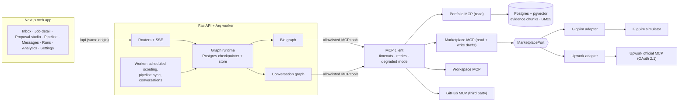
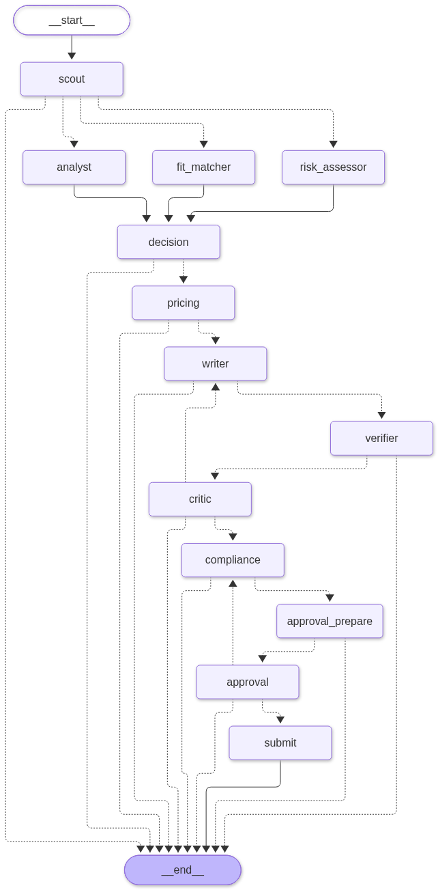
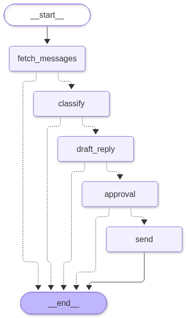

# Architecture

GigBid is two LangGraph graphs, three MCP servers of its own plus two third-party ones, one
marketplace port with two adapters, and a web app that keeps the human in control. Nothing reaches
a client until a person approves it in the UI.



## The bid graph (one thread per job)



```text
scout ─▶ analyst ┐
      ├▶ risk    ├─▶ decision ─skip/watch─▶ END
      └▶ fit     ┘      │bid
                        ▼
                     pricing ─not worth Connects─▶ END
                        ▼
              writer ─▶ verifier ─▶ critic ─revise (≤ 2)─▶ writer
                                       ▼
                                  compliance ─block─▶ END (reason shown)
                                       ▼
                             approval_prepare (dry-run preview)
                                       ▼
                              approval  ◀── interrupt(): approve | edit | reject
                         approve ▼     edit ▶ compliance (re-check)     reject ▶ END
                                submit (idempotent per thread) ─▶ END
```

Job Analyst, Risk Assessor and Fit Matcher run as parallel `Send` branches and each writes its
own state key, so no reducer races. The decision node is rules over config thresholds, so the
reason for a skip is always explainable. Pricing is deterministic over market quantiles, the
client's budget, the user's floor and Connects economics. Every node is wrapped with a token-budget
check and error capture: a failure moves the thread to `needs_attention` (the dead-letter state)
with the reason, instead of crashing the worker. Retries and timeouts per node come from
`agent/config.yaml`; the recursion limit is the step budget.

## The conversation graph (one thread per client conversation)



`fetch_messages → classify intent → draft reply (with free slots from the Workspace server for
interview requests) → compliance → approval (interrupt) → send`. Intents: question, negotiation,
interview request, acceptance, rejection, scam signal. A keyword backstop marks off-platform or
payment requests as scam signals even if the model misses them. An approved interview slot
becomes a tentative calendar hold.

## Why each agent exists

| Agent | Why it is a separate agent | Model tier |
|---|---|---|
| Scout | Marketplace I/O and de-duplication are not language tasks; isolating them keeps rate limits in one place | none (tools only) |
| Job Analyst | A structured JobSpec is what every later step decides on; it must not be mixed with risk or fit judgements | medium |
| Risk Assessor | Needs client history (a marketplace tool the analyst should not have) and must run on untrusted text with heuristics that the model cannot override downward | small |
| Fit Matcher | Owns evidence retrieval; the only reader of the Portfolio server before drafting | medium |
| Decision | Deterministic rules make "why did it skip?" answerable and the policy update a config edit | none |
| Pricing Strategist | Deterministic, auditable numbers; reads the Connects balance | none |
| Proposal Writer | The only free-text generator for proposals; may cite only evidence in state | large |
| Verifier | Separates "did the writer tell the truth" from "is it a good proposal"; repairs before the Critic sees it | medium |
| Critic | Independent quality gate with a bounded send-back loop | large |
| Compliance Guard | Policy pack enforcement as rules first, minimal LLM rewrite second; can block | small |
| Client Liaison | Different state, cadence and tools (messages, calendar) from bidding | large / small for intent |

## State, trace and memory are kept apart

| | What | Where | Who writes |
|---|---|---|---|
| **State** | What this job or conversation needs now: job, analyses, decision, price, drafts, critiques, approvals, outcome | `agent/state.py` TypedDicts, checkpointed in Postgres | nodes |
| **Execution trace** | Every tool name, arguments, result, LLM call, observation, interrupt and resume | `trace` key (append reducer) + the MCP audit log + LangSmith | nodes and the MCP layer; nothing reads it to decide |
| **Long-term memory** | Promoted knowledge only: style rules from the user's edits, outcome hints per job category | LangGraph store (`agent/memory`) | only `promotion_rules.py`, after repeated evidence |

## The marketplace port

`agent/marketplace_port.py` is the single interface (search, job, client history, Connects,
threads, messages, events, policy, draft, submit, send). `GigSimAdapter` maps the simulator's REST
contract and retries transient failures; `UpworkLiveAdapter` maps the official Upwork MCP server's
tools, creates only drafts that the user confirms on Upwork, and is selected with
`MARKETPLACE_MODE=upwork_live`. The graphs cannot tell which marketplace they are using.

## MCP surface

See [TOOLS.md](TOOLS.md) for every tool with its annotations, auth and the per-agent allowlists.
Writes carry an idempotency key and support `dry_run`; every call is audited with PII masked.

## Data stores

| Store | Holds |
|---|---|
| Postgres `evidence_chunks` (pgvector, HNSW) | portfolio chunks with persona, type, project, skills, year, industry, outcome |
| BM25 pickles (`data/processed/bm25`) | sparse index per persona, rebuilt after ingestion |
| Postgres app tables | users, settings, saved searches, inbox records, runs, pipeline cards, encrypted OAuth tokens, portfolio uploads |
| LangGraph checkpointer + store (Postgres) | graph state per thread; long-term memory |
| Postgres `audit_log` | append-only MCP call log (UPDATE and DELETE revoked) |
| Redis | worker queue, run event pub/sub for SSE |

## Key libraries (pinned in `uv.lock` and `apps/web/package-lock.json`)

LangGraph 1.2, LangChain 1.4, langchain-mcp-adapters 0.3, MCP Python SDK 1.30, FastAPI 0.162,
SQLAlchemy 2.1, psycopg 3.3, pgvector 0.5, Arq 0.28, sentence-transformers 6.2 (CPU PyTorch 2.15),
rank-bm25, Next.js 16, React 19, TanStack Query 5, openapi-fetch, Playwright 1.65.
